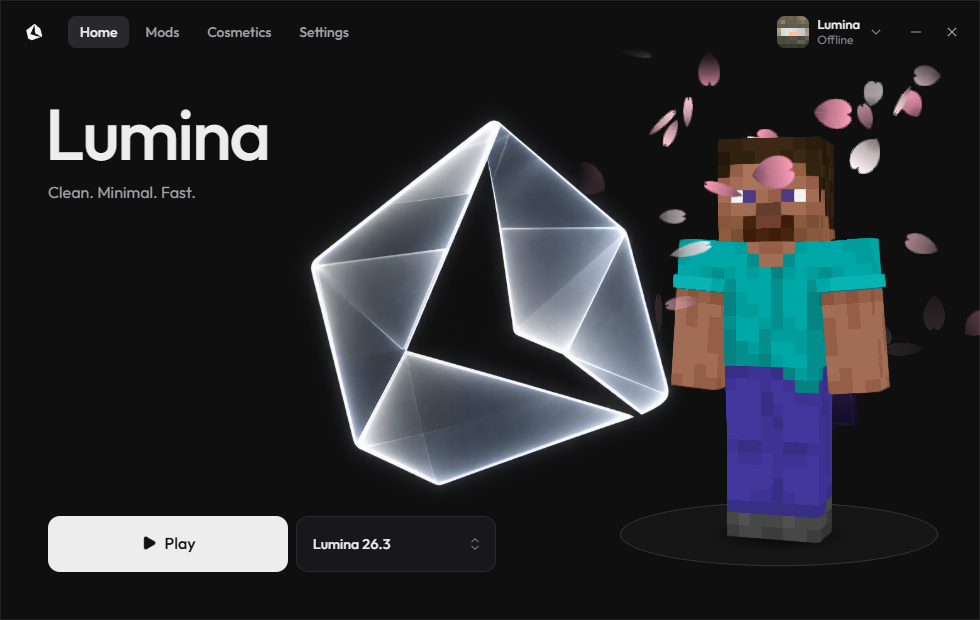
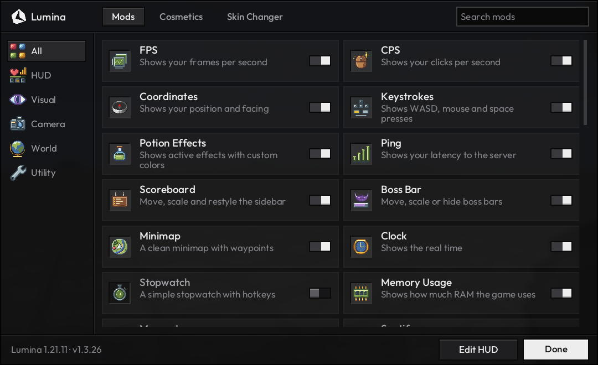

<h1 align="center">
  <picture>
    <source media="(prefers-color-scheme: dark)" srcset=".github/assets/header-dark.png">
    
  </picture>
</h1>

  A clean, minimal and fast Minecraft client. 
  Minecraft 1.21.11, 26.2 and 26.3 &middot; Fabric &middot; Windows

  <a href="https://github.com/johan13p1/lumina-releases/releases/latest"><b>Download the latest version</b></a>

  

## Features

**Launcher**
- One click to play Minecraft 1.21.11, 26.2 or 26.3
- Several Microsoft accounts, and switching accounts in game without a restart
- Mods and shaders from Modrinth, profiles with their own mods
- Resource and shader packs shared by every version
- A second game next to the first, for another account
- Updates itself

**In game**

  

- One menu on <kbd>Right Shift</kbd> with around 40 features
- A HUD you can move and scale: FPS, CPS, coordinates, keystrokes, potion effects, ping, minimap with waypoints, clock, stopwatch, memory, speed and Spotify
- Zoom, Free Look with a spectator camera that also works on servers, FOV changer
- Crosshair editor, block outline, hit color, damage tint, glint colors, item physics, 3D skin layers, name tags, particles, motion blur, menu blur, hitboxes
- Chat with timestamps and stacked messages, tab list editor, auto text, sound volume per group, GUI scale for menus
- Skin changer with a 3D preview
- Capes and particle effects that other Lumina players see too, and the Lumina mark next to your name
- Your settings are the same in every Minecraft version
- A performance pack (Sodium, Lithium, FerriteCore, ImmediatelyFast, Entity Culling and more), downloaded from Modrinth in the right version. Iris for shaders is optional.

## Install

1. Download `LuminaClient-Setup-<version>.exe` from the [latest release](https://github.com/johan13p1/lumina-releases/releases/latest) and run it.
2. The installer is not signed, so Windows may say "Windows protected your PC". Click **More info**, then **Run anyway**.
3. Sign in with your Microsoft account (Minecraft: Java Edition) and press **Play**. The first start downloads Minecraft, Java and the mods, which takes a minute or two.

The launcher keeps itself up to date. Your worlds, mods and settings stay.

## Open source

Lumina is open source under the [MIT License](LICENSE).

| Folder | What it is |
| --- | --- |
| `mod/`, `mod-26.2/`, `mod-26.3/` | The Fabric mod, one project per Minecraft version (Java) |
| `launcher/` | The launcher (Electron) |

`.\build.ps1` builds the three mods and the installer. On the first run it downloads JDK 21, JDK 25 and Node.js into `.tools\`. `.\build.ps1 -SkipInstaller` only builds the mods.

Issues and pull requests are welcome. Icons, fonts and other files by others keep their own licenses, see Credits.

## Privacy

To show your cape, particles and the Lumina mark to other players, Lumina's server stores your Minecraft name, UUID, what you wear and when you last played. Your Microsoft sign-in is never sent to Lumina's server, and Lumina keeps no IP addresses and no logs.

## Credits

Menu icons for Coordinates, Zoom and Name Tags from [Faithful 32x](https://faithfulpack.net/). Font [Outfit](https://fonts.google.com/specimen/Outfit) (SIL Open Font License), icons [Lucide](https://lucide.dev/) (ISC), 3D skin viewer [skinview3d](https://github.com/bs-community/skinview3d) (MIT). Wavey Capes by tr7zw and the other mods are downloaded from Modrinth and not bundled.

Not an official Minecraft product. Not approved by or associated with Mojang or Microsoft.
